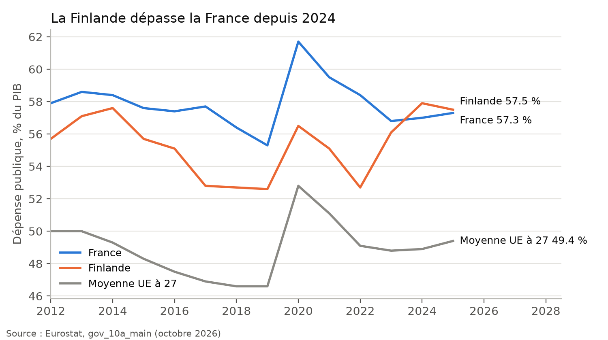
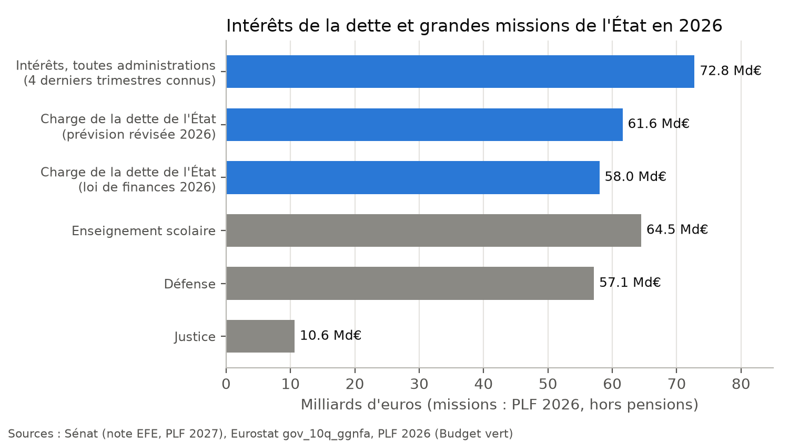

# Dette, dépense publique et fiscalité : analyse et verdicts

**En bref.** Sur 19 affirmations chiffrées, Lisnard a raison sur l'essentiel du diagnostic. La France a la dépense
publique et les prélèvements parmi les plus élevés du monde développé. Sa dette a augmenté bien plus vite que sa
richesse depuis 2017. Les intérêts dépassent de loin le budget de la Justice. L'impôt sur le revenu et les droits de
succession sont très concentrés. Mais il pousse presque toujours le chiffre ou le classement d'un cran :

- « record du monde » là où la France est 1re ou 2e selon l'année et la source ;
- « premier poste de l'État » un an trop tôt et en mélangeant deux périmètres ;
- « 60 % » de taxes sur le carburant au lieu de 45 à 57 % ;
- « record absolu par habitant » pour des dépenses sociales qui sont 8es par habitant.

Sur ses mesures, les ordres de grandeur annoncés sont cohérents : 200 Md€ représentent bien 7 points de PIB et environ
370 € par mois et par salarié. Une phrase est fausse : après ces économies, la France ne resterait pas « le pays à la
dépense la plus élevée d'Europe ».

| Verdict | Nombre | Affirmations |
| --- | --- | --- |
| Exact | 6 | DETTE-02, 05, 06, 15, 16, 17 |
| Plutôt exact | 6 | DETTE-01, 03, 08, 11, 13, 19 |
| Trompeur | 4 | DETTE-04, 07, 09, 12 |
| Faux | 3 | DETTE-10, 14, 18 |
| Opinion ou promesse | 3 | DETTE-20, 21, 22 (faits sous-jacents vérifiés, chiffrages = estimations) |

Les chiffres cités ci-dessous viennent de `calculs/resultats.csv`. Le détail de chaque calcul est dans
`calculs/METHODE.md` (section indiquée entre crochets), et les fichiers d'origine sont dans `brut/` (catalogue :
`sources.csv`). Données téléchargées le 14/11/2026.

---

## DETTE-01 — « Champion du monde des dépenses publiques avec 58 % du PIB » (30/08/2024)

**Verdict : plutôt exact en 2024, dépassé depuis.** Confiance : forte.

- En 2022 (58,4 %) et en 2023 (56,8 %), la France avait la dépense publique la plus élevée de l'UE et de l'OCDE. Le
  « 58 % » correspond à 2022. [M1]
- « Du monde » est excessif. Selon le FMI, une dizaine de pays dépensent plus en % du PIB. Ce sont des micro-États
  financés par des aides (Nauru, Tuvalu, Kiribati), des pays en guerre (Ukraine) ou des États pétroliers (Libye).
  La France est 11e à 12e sur 210 pays. Elle est bien première parmi les pays développés jusqu'en 2023.
- Depuis 2024, la Finlande dépasse la France : 57,9 % contre 57,0 % en 2024, 57,5 % contre 57,3 % en 2025. Les
  reprises de 2026 (« record du monde de la dépense publique, 57 % ») sont donc devenues inexactes, de peu.

## DETTE-02 — « Le taux de prélèvements obligatoires 2022 le plus élevé de l'OCDE, à 45,4 % du PIB » (15/09/2023)

**Verdict : exact.** Confiance : forte.

- Avec la définition de l'OCDE, la France était 1re sur 38 en 2022 (45,9 %). 45,4 % est le taux de l'Insee, qui
  utilise une autre définition. [M2]
- Ses reprises sont moins exactes. Sur les données OCDE, la France est 2e derrière le Danemark en 2021, 2023 et
  2024 : « ratio le plus élevé de l'OCDE » (avril 2026) est donc faux pour la dernière année connue. Dans l'UE
  (Eurostat), elle est 1re en 2022, 2023 et 2025, 2e en 2024 derrière la Belgique : « record UE » est exact
  aujourd'hui. « Record du monde » n'est démontrable ni dans un sens ni dans l'autre. Le FMI ne publie que les
  recettes publiques totales, sur lesquelles la France est 15e mondiale.

## DETTE-03 — « On va payer 7 fois plus d'intérêts de la dette de l'État cette année que tout budget de la justice » (07/05/2026)

**Verdict : plutôt exact.** Confiance : forte.

- Pour la dette de l'État, comme il le dit, le rapport est de 5,5 (58,0 Md€ votés pour 2026) à 5,8 (61,6 Md€ en
  prévision révisée), face à 10,6 Md€ pour la Justice hors pensions. Avec les pensions, le rapport descend sous 5.
  [M3]
- Le « 7 fois » n'est atteint qu'avec les intérêts de **toutes** les administrations publiques (État, Sécurité
  sociale, collectivités) : 72,8 Md€ sur les quatre derniers trimestres connus, soit 6,9 fois.
- Sa version de juillet 2024, « 5 fois », était exacte : 51,4 Md€ contre 9,8 Md€ (5,2).
- Le fond de l'argument tient sur tous les périmètres : les intérêts représentent 5 à 7 fois le budget de la Justice.

## DETTE-04 — « La charge de la dette atteint 66 milliards d'euros, et devient le premier poste de dépense de l'État, devant l'Éducation nationale et la Défense » (06/11/2025)

**Verdict : trompeur.** Confiance : forte.

- En 2025, la charge de la dette de l'**État** était de 54,2 Md€ votés (51,4 Md€ révisés), derrière l'Enseignement
  scolaire (64,3 Md€). Le chiffre de 66 Md€ est celui de **toutes** les administrations (65,7 Md€ en 2025). On le
  compare ici à des budgets de l'État seul. [M4]
- La phrase devient vraie plus tard. Dans le projet de budget pour 2027, la charge de la dette de l'État (71,9 Md€)
  dépasse l'Enseignement scolaire (65,5 Md€) et la Défense (63,4 Md€) : c'est le premier poste hors pensions. Dès
  2026, elle dépasse la Défense hors pensions (61,6 contre 57,1 Md€). Sa phrase d'août 2026 (« supérieure au
  budget des armées ») est donc exacte.
- Pour 2026, il a cité 70, 74 puis 77 Md€ « d'intérêts de la dette de l'État ». L'État paiera environ 62 Md€.
  Les chiffres de 74 Md€ et plus correspondent à toutes les administrations.

## DETTE-05 — « La dette publique atteint 3 482 milliards d'euros, soit 117,4 % du PIB » (17/04/2026)

**Verdict : exact.** Confiance : forte.

- Au 3e trimestre 2025, dernier chiffre connu en avril 2026, Eurostat publie aujourd'hui 3 484 Md€ et 117,3 %. La
  petite différence vient d'une révision. Au 1er trimestre 2026 : 3 536 Md€, exactement le chiffre qu'il cite en
  juillet 2026. Au 2e trimestre 2026 : 3 596 Md€ (119,1 %), ce qui rend plausible sa prévision de « 120 % fin
  2026 ». [M5]

## DETTE-06 — « Depuis 2017, une augmentation de la dette de 1 000 milliards […] une progression de 46 %, quand la richesse nationale n'a crû que de 27 % » (23/04/2025)

**Verdict : exact.** Confiance : forte.

- De 2017 à 2024 : la dette passe de 2 263 à 3 306 Md€ (+1 043 Md€, +46,1 %) et le PIB en valeur augmente de
  28,1 %. [M6]
- Sa version de janvier 2026, « la dette a augmenté de 40 % plus vite que la richesse », est en dessous de la
  réalité. Sur 2015-2025, la dette a crû de 62 % et le PIB de 36 % : la dette a augmenté 1,7 fois plus vite.

## DETTE-07 — « Si nous avions suivi la trajectoire moyenne de la zone euro, nous aurions 400 milliards de dette en moins et des charges d'intérêts divisées par deux » (23/04/2025)

**Verdict : trompeur.** Confiance : moyenne (calcul contrefactuel).

- La première moitié est juste. Depuis 2017, le ratio de dette de la zone euro a baissé de 0,8 point jusqu'en
  2024, alors que celui de la France a augmenté de 13,8 points. Avec la trajectoire de la zone euro, la France
  aurait environ 430 Md€ de dette en moins en 2024 (près de 500 Md€ en 2025). [M7]
- La seconde moitié est fausse. 430 Md€ représentent 13 % de la dette : à taux moyen comparable, les intérêts
  auraient baissé d'environ 13 %, pas de moitié.

## DETTE-08 — « 54,7 % de notre dette est détenue par des non-résidents […] Avec une maturité moyenne de huit ans, nous devons refinancer 12,5 % de notre stock chaque année » (06/11/2025)

**Verdict : plutôt exact.** Confiance : moyenne.

- 54,7 % correspond exactement au 1er trimestre 2025 (Banque de France). Le chiffre était déjà un peu ancien : 55,4 %
  au 2e trimestre 2025, puis 56,0 % fin 2025. Attention, ce chiffre concerne la dette négociable de l'État, pas
  toute la dette publique. [M8]
- La maturité moyenne est de 8 ans et demi selon l'Agence France Trésor. Ce chiffre n'a pas pu être téléchargé, le
  site bloquant les robots.
- « 12,5 % refinancés chaque année » est une approximation (1 divisé par 8). Les titres à moyen et long terme
  arrivant à échéance représentent environ 6,8 % de l'encours par an. Il faut y ajouter les titres courts,
  renouvelés plusieurs fois par an : au total, l'État emprunte plus de 300 Md€ par an.
- Les « 27 % hors zone euro » ne sont pas publiés en données ouvertes : invérifiable.

## DETTE-09 — « Un déficit public de 170 milliards en 2024 […] Ce déficit représente 37,8 % de nos recettes publiques » (06/11/2025)

**Verdict : trompeur.** Confiance : forte.

- Le déficit de 2024 est exact : 169,1 Md€ (5,8 % du PIB). Celui de 2025 aussi : 5,1 % du PIB. [M9]
- « 37,8 % de nos recettes publiques » ne correspond à aucun calcul retrouvé. Rapporté à toutes les recettes
  publiques, le déficit en représente 11 %. Pour l'État seul, le déficit budgétaire représente 45 % de ses recettes
  en 2024 et 35 % en 2025. Le chiffre n'a donc de sens que pour l'État, et le mot « publiques » induit en erreur.

## DETTE-10 — « 950 milliards de dépenses sociales […] c'est le record absolu du monde par rapport à la population » (04/11/2026)

**Verdict : faux.** Confiance : forte.

- Le montant est juste : 1 004 Md€ de dépenses de protection sociale en 2024, dont 933 Md€ de prestations. [M10]
- Rapportée au PIB, la dépense sociale française est bien parmi les plus élevées : 1re de l'OCDE en 2022, 1re de l'UE
  en 2022 et 2023, 2e en 2024 derrière la Finlande (31,8 %).
- « Par rapport à la population », c'est-à-dire par habitant, la France n'est que 8e en Europe (2023, Luxembourg,
  Suisse, Norvège, Allemagne, Autriche, Pays-Bas et Danemark devant) et 8e de l'OCDE (2021).
- Ses autres versions, « 33 % » et « 34 % » du PIB, majorent un peu la réalité (31 à 32 %). « 31 % » (mars 2026) est
  exact.

## DETTE-11 — « Je propose de supprimer les aides aux entreprises, 144 milliards » (30/03/2025)

**Verdict : plutôt exact sur le montant, mais le périmètre n'est pas dit.** Confiance : moyenne.

- Les estimations publiques vont de 45 Md€ (aides d'État au sens européen, 2022) à 211 Md€ (Sénat, sens large,
  2023), en passant par 88 Md€ (IGF), 108 Md€ (Sénat, sens restreint), 112 Md€ (Haut-Commissariat au plan) et
  157 Md€ (Clersé, 2019, d'où vient son « a minima 157 Md€ »). 144 Md€ est dans cette fourchette. [M11]
- Sa comparaison « contre environ 40 milliards au début des années 2000 » est cohérente avec le Clersé : environ
  3 % du PIB de 2000, soit 44 Md€.
- Point à savoir : les estimations au-dessus de 100 Md€ comprennent les allègements généraux de cotisations sur les
  bas salaires (environ 75 Md€). Les supprimer augmenterait le coût du travail, sauf baisse équivalente des
  prélèvements, ce qu'il propose en contrepartie.

## DETTE-12 — « Un taux de prélèvements sur les entreprises de 13,2 % du PIB, contre 7,3 % dans la zone euro […] un écart de 148 milliards » (15/09/2023)

**Verdict : trompeur.** Confiance : moyenne.

- Le niveau français est juste. Selon Fipeco (impôts sur la production et sur les bénéfices, cotisations patronales
  des sociétés non financières), il atteint 12,6 % du PIB en 2022, 2e de l'UE derrière la Suède. [M12]
- La comparaison ne tient pas. Le chiffre vient d'une tribune de l'iFRAP, sans méthode publiée. Aucune statistique
  publique ne donne 7,3 % pour la zone euro : l'Allemagne, à elle seule, est à 9,3 % du PIB, soit 3,3 points de
  moins que la France et non 5,9. L'écart de 148 Md€ est donc probablement surestimé.
- Une fois les aides reçues déduites, les prélèvements tombent à 10,4 % du PIB (Fipeco), ce que Lisnard ne
  mentionne pas.

## DETTE-13 — « Les impôts de production pèsent 3,6 % du PIB pour les seules entreprises, soit plus du double de la médiane européenne (1,2 %) » (07/05/2026)

**Verdict : plutôt exact.** Confiance : forte.

- Payés par les seules sociétés, les impôts de production représentent 3,3 % du PIB en 2022, contre 1,5 % en
  moyenne dans la zone euro (Fipeco) : plus du double. [M13]
- La médiane européenne de 1,2 % est celle d'Eurostat pour 2025, mais pour tous les payeurs, y compris les ménages
  et les administrations. Sur cette même base, la France est à 4,4 %. Il compare donc un chiffre « entreprises
  seules » à une médiane « tous payeurs ». Sur les deux bases, l'écart reste de plus du double.

## DETTE-14 — « La France se retrouve sur la première marche du podium des pays qui prélèvent le plus sur le salarié moyen » (15/09/2023)

**Verdict : faux.** Confiance : forte.

- Selon l'OCDE, le coin fiscal et social sur un salarié célibataire au salaire moyen est de 47,1 % en 2022 et 47,2 %
  en 2025. La France est 3e sur 38, derrière la Belgique (52,5 %) et l'Allemagne (49,3 %). [M14]
- Sa version de juillet 2026, « près de 47 % du coût d'un salarié absorbé, contre environ 35 % en moyenne en
  Europe », est juste pour la France. Mais 35 % est la moyenne de l'OCDE, pas de l'Europe : la moyenne des pays de
  l'UE membres de l'OCDE est de 41,7 %.

## DETTE-15 — « 55 % des ménages ne paient pas l'impôt sur le revenu. Les 10 % de ménages qui contribuent le plus paient 70 % de l'impôt » (17/09/2025)

**Verdict : exact.** Confiance : forte.

- Sur les revenus 2023 (derniers connus en septembre 2025), 19 millions de foyers sur 41 ont payé un impôt net
  (45 %), donc 55 % n'en ont pas payé. Sur les revenus 2024, ils sont 53 %. [M15]
- La concentration est même plus forte qu'il ne le dit : les 10 % de foyers les plus aisés paient 76 % de l'impôt
  net (revenus 2023) et 74 % (revenus 2024).
- Précision : la DGFiP compte des foyers fiscaux, pas des ménages.

## DETTE-16 — « Évaluées à 85 milliards d'euros, les 474 niches fiscales répertoriées par Bercy […] L'impôt sur le revenu : 175 niches pour plus de 42 milliards, soit près de la moitié des recettes attendues (94 milliards) » (28/05/2025)

**Verdict : exact.** Confiance : forte.

- Le projet de budget 2025 recense 474 dépenses fiscales pour 85,1 Md€, dont 42,1 Md€ sur l'impôt sur le revenu. Les
  recettes nettes d'impôt sur le revenu votées pour 2025 sont de 94,5 Md€ : les niches en représentent 45 %. [M16]
- En 2026, on compte 465 niches pour 88,3 Md€, chiffre qu'il reprend en avril 2026. Le nombre de 175 niches sur
  l'impôt sur le revenu n'a pas été recompté.
- Nuance de méthode : une « dépense fiscale » est une perte de recettes calculée par rapport à une norme. La
  supprimer ne rapporterait pas forcément le même montant.

## DETTE-17 — « La fiscalité sur les transmissions et les donations représente 45 % de tous les produits de toute l'Union européenne » (30/09/2026)

**Verdict : exact.** Confiance : forte.

- Dans les 22 pays de l'UE membres de l'OCDE, les droits de succession et de donation rapportent 42 à 47 Md€ par
  an. La France en perçoit 45 % en 2022, 47 % en 2023 et 46 % en 2024 (21,6 Md€). C'est aussi le pays où ils pèsent
  le plus en % du PIB (0,73 %). [M17]
- Contrôle : sur l'ensemble des impôts en capital de l'UE à 27 (Eurostat), la part française est de 41 %.

## DETTE-18 — « 60 % du prix du carburant vient de la fiscalité, qui est la plus élevée du monde » (07/05/2026)

**Verdict : faux.** Confiance : forte.

- La semaine du 4 mai 2026, les taxes représentaient 50 % du prix de l'essence SP95 et 45 % du prix du gazole en
  France (Commission européenne). En moyenne sur 2025, quand le pétrole était moins cher, elles étaient de 57 % et
  54 %. [M18]
- La France n'a pas la fiscalité la plus élevée de l'UE : elle est 9e pour l'essence et 3e ou 4e pour le gazole.
  Finlande, Allemagne, Grèce, Italie ou Pays-Bas taxent plus l'essence.

## DETTE-19 — « La taxation marginale du capital excède 60 % […] le taux effectif des grandes entreprises dépasse 36 % du fait des surtaxes » (15/05/2026)

**Verdict : plutôt exact, mais dans le cas le plus extrême.** Confiance : forte (calcul sur les taux légaux).

- L'impôt sur les sociétés est de 25 %. Avec la contribution exceptionnelle de 41,2 % de l'impôt, applicable en 2025
  et 2026 aux entreprises de plus de 3 Md€ de chiffre d'affaires, le taux légal monte à 36,5 % : le « plus de 36 % »
  est juste pour ces entreprises. Il s'agit du taux légal, pas d'un taux effectif. [M19]
- Taux cumulé sur un dividende :
    - 49 % pour une entreprise ordinaire et un actionnaire à la flat tax (31,4 % en 2026) ;
    - 56 à 59 % pour une très grande entreprise ;
    - 61 % seulement si l'actionnaire très aisé paie la contribution différentielle (impôt minimal de 20 %),
      c'est-à-dire le cas maximal qu'il décrit.
- « Excède 60 % » est donc vrai dans ce cas, et pas en général.

## DETTE-20 — Mesure : « 80 milliards d'économies dès la première année, a minima 200 milliards par an à la fin du quinquennat » (03/07/2026)

**Verdict : opinion ou promesse.** Seuls les faits qui l'entourent sont vérifiés, avec des **estimations non fiables
à 100 %**, faites à PIB 2025 inchangé. [M20]

- 200 Md€ représentent 11,7 % de la dépense publique et 6,7 points de PIB : sa formule « 7 points de PIB (200
  milliards) » est cohérente. 300 Md€ font 10 points.
- **Faux** : « après cette réduction, la France resterait encore le pays à la dépense publique la plus élevée
  d'Europe » (newsletter, 14/08/2026). À 50,6 % du PIB, elle passerait au 6e rang de l'UE, derrière la Finlande,
  l'Autriche, la Belgique, l'Italie et la Pologne.
- **Exact** : avec 300 Md€, « nous resterions au-dessus des Pays-Bas » (47,3 % contre 45,2 %).
- Aucun chiffrage indépendant poste par poste du plan n'a été trouvé : sa faisabilité ne peut pas être jugée ici.

## DETTE-21 — Mesure : « 120 milliards rendus aux actifs en salaire net […] presque 400 euros » (31/08/2026)

**Verdict : opinion ou promesse ; le calcul est cohérent.** **Estimation non fiable à 100 %.** [M21]

- 120 Md€ partagés entre 27,1 millions de salariés font 369 € par mois et par salarié, si toute la baisse de
  cotisations allait en salaire net. « Presque 400 € » est un arrondi favorable mais du bon ordre de grandeur.
- Première année : 60 % de 80 Md€ font 147 € par mois, un peu moins que les « près de 200 euros » annoncés le
  3 juillet 2026.
- Les 40 Md€ de baisse des impôts de production sont bien plus larges que les deux impôts qu'il cite. La C3S
  (environ 4,3 Md€) et la CVAE restante (environ 4,1 Md€ pour l'État) ne pèsent qu'environ 8 Md€. Le reste n'est pas
  précisé.
- Limite : une baisse de cotisations ne finance plus les prestations correspondantes. Son effet réel sur les
  salaires dépend de la négociation et des cotisations visées.

## DETTE-22 — Mesure : « Ramener le taux de prélèvements obligatoires à la moyenne de la zone euro à travers une baisse nette de 100 milliards » (16/04/2026)

**Verdict : opinion ou promesse ; le chiffrage est sous-dimensionné.** **Estimation non fiable à 100 %.** [M22]

- En 2025, l'écart avec la zone euro est de 4,7 points de PIB (46,0 % contre 41,3 %, Eurostat). Le combler
  demanderait environ 140 Md€ à PIB inchangé, pas 100 Md€. Avec 100 Md€, il resterait environ 1,4 point d'écart.

---

## Ce qui reste à faire ou à vérifier

- [ ] Télécharger à la main le bulletin mensuel de l'AFT (maturité moyenne de la dette) et le déposer dans
      `brut/aft/` : le site refuse les téléchargements automatiques.
- [ ] Retrouver la source exacte de « 37,8 % de nos recettes » (DETTE-09) et de « 27 % hors zone euro » (DETTE-08).
- [ ] Remplacer les crédits Justice du PLF 2026 par ceux de la loi de finances 2026 votée (écart attendu faible).
