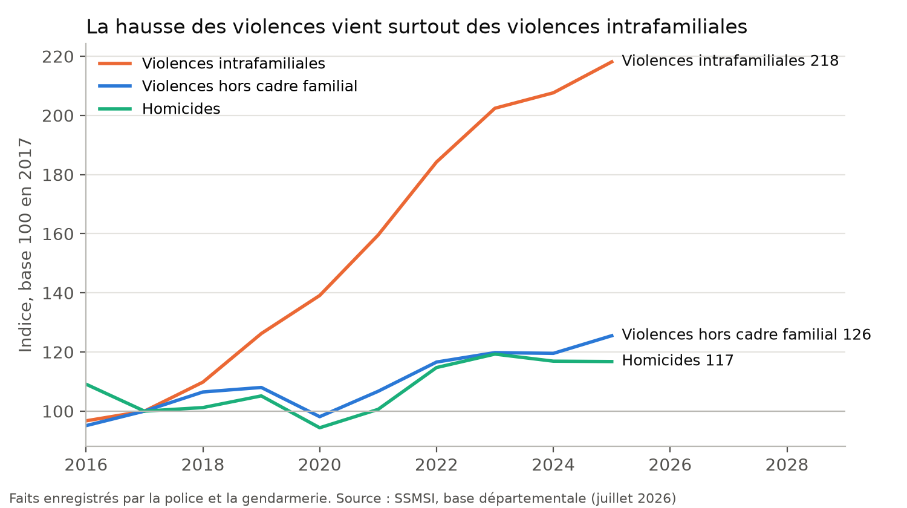

# Sécurité, justice et narcotrafic : analyse et verdicts

**En bref.** Le constat de Lisnard tient sur les prisons et les moyens de la justice, mais pas sur toute sa lecture
des chiffres.

Ce qui tient :

- la France manque d'environ 22 000 places de prison (fin 2025), et de plus de 26 000 en septembre 2026 ;
- elle a deux fois moins de juges par habitant que la médiane de l'UE ;
- les homicides enregistrés ont augmenté de 15 % entre 2017 et 2022.

Ce qui ne tient pas :

- la hausse des violences vient pour les trois quarts des **violences intrafamiliales**, que les victimes signalent
  beaucoup plus qu'avant. Les violences hors du cadre familial ont augmenté de 25 % en huit ans, pas de 51 % ;
- la France n'a pas un « sous-taux d'incarcération » : elle incarcère plus que la médiane européenne ;
- « 40 % des peines non exécutées au bout de six mois » correspond plutôt au taux au jour du jugement. Cinq ans après,
  90 % des peines de prison ferme sont exécutées, pas une sur deux ;
- en 2026, il annonce « + 43 % d'homicides en dix ans » : la hausse est de 7 %.

| Verdict | Nombre | Affirmations |
| --- | --- | --- |
| Exact | 1 | SECU-05 |
| Plutôt exact | 3 | SECU-01, 04, 06 |
| Trompeur | 2 | SECU-02, 03 |
| Opinion ou promesse | 2 | SECU-07, 08 |

Chiffres : `calculs/resultats.csv`. Méthode : `calculs/METHODE.md` [sections entre crochets]. Fichiers d'origine :
`brut/`, catalogue `sources.csv`. Données téléchargées le 14/11/2026.

---

## SECU-01 — « + 51 % de coups et blessures volontaires et + 15 % d'homicides depuis 2017 » (26/05/2023)

**Verdict : plutôt exact sur les chiffres, mais la lecture « la délinquance explose » est discutable.** Confiance : forte.

- Homicides enregistrés : 835 en 2017, 958 en 2022, soit +14,7 %. Son « + 15 % » est exact. [M1]
- Violences physiques enregistrées (intrafamiliales et hors cadre familial) : +44 % de 2017 à 2022 dans la série
  actuelle du SSMSI. Il cite +51 %. L'écart peut venir de l'ancien indicateur (« coups et blessures volontaires »),
  refondu par le SSMSI en 2024.
- La hausse est surtout intrafamiliale. Les violences intrafamiliales ont augmenté de 84 % sur la même période, celles
  hors cadre familial de 17 %. Sur 2017-2025, 76 % de la hausse des violences vient des violences intrafamiliales.
  Le SSMSI attribue une grande partie de cette hausse à de meilleurs signalements (libération de la parole, plaintes
  facilitées) et non à une hausse équivalente des faits.
- Ses autres versions :
    - **Exact** : programme 2026, « homicides + 16 %, tentatives + 90 % » (2017-2025 : +17 % et +96 %).
    - **Faux** : discours du 3 juillet 2026, « le nombre d'homicides a augmenté de 43 % » en dix ans. De 2016 à 2025,
      il passe de 911 à 975, soit +7 %. Les violences ont augmenté de 70 % sur dix ans, pas de 50 %.
    - **Non retrouvé** : « + 12 % d'homicides depuis 2017 » (juillet 2022). La série actuelle donne +0,6 % de 2017 à
      2021.

## SECU-02 — « Une surpopulation carcérale et un sous-taux d'incarcération par rapport aux autres pays, conséquence du manque de 20 000 places » (août 2023)

**Verdict : trompeur.** Confiance : forte.

- Le manque de places est réel et du bon ordre de grandeur. Au 1er septembre 2025, on compte 84 311 détenus pour
  62 614 places opérationnelles (+21 700). Au 1er septembre 2026, 90 020 détenus pour 63 348 places (+26 700, densité
  142 %). Le Sénat compte 22 361 places manquantes en octobre 2025 pour ramener chaque établissement à 100 %. Ses
  « 30 000 places » de 2025-2026 sont donc devenues plausibles. [M2]
- Le « sous-taux d'incarcération » est faux. Au 31 janvier 2024, la France compte 111,5 détenus pour 100 000
  habitants, au-dessus de la médiane européenne (104,8) et bien au-dessus de l'Allemagne (71,2). La surpopulation
  vient d'un nombre de détenus en forte hausse, pas d'une incarcération plus faible qu'ailleurs.

## SECU-03 — « 40 % des peines d'emprisonnement ne sont pas exécutées au bout de six mois » (FAQ, 31/08/2026)

**Verdict : trompeur.** Confiance : moyenne (le taux à six mois n'est pas publié).

- En 2025, 42 % des peines de prison ferme ne sont pas mises à exécution le jour du jugement. Un an après, 21 %
  restent à exécuter (2024). Cinq ans après, 10 % ne l'ont jamais été. [M3]
- À six mois, la part non exécutée est donc entre 21 % et 42 %, très probablement nettement sous 40 %. Son chiffre
  correspond à la situation au jugement, ou aux données anciennes (le taux d'exécution immédiate n'était que de 30 %
  de 2017 à 2019, d'où son « 45 % » de 2021).
- « Une condamnation sur deux n'est pas appliquée » (mars 2025) est faux : 90 % des peines de prison ferme sont
  exécutées dans les cinq ans.
- Il a raison sur un point : une part notable des courtes peines n'est exécutée qu'après plusieurs mois.

## SECU-04 — « Le budget de la justice est de loin le plus faible d'Europe (0,20 % du PIB) ainsi que par le nombre des juges (10,9 pour 100 000 habitants, la médiane étant de 17,7) » (programme)

**Verdict : plutôt exact pour les juges ; budget non vérifié.** Confiance : moyenne.

- En 2024, la France compte 11,6 juges professionnels pour 100 000 habitants, contre une médiane de 23,4 dans l'UE.
  Elle a aussi 3,2 procureurs contre 11,4. Ses chiffres (10,9 et 17,7) sont plus anciens et calculés sur l'ensemble
  du Conseil de l'Europe, mais le constat est le même : la France a environ deux fois moins de juges que la médiane.
  [M4]
- « De loin le plus faible d'Europe » pour le budget n'a pas pu être vérifié avec les fichiers téléchargés. La
  CEPEJ ne classe pas la France dernière ; il faudrait la base CEPEJ-STAT.

## SECU-05 — « La police municipale, présente dans seulement 12 % des communes » (22/08/2026)

**Verdict : exact.** Confiance : forte.

- En 2024, 4 592 communes ou intercommunalités ont un service de police municipale, sur 34 969 communes. Cela fait au
  plus 13 % des communes, et 11 % si l'on ne compte que les lignes ayant au moins un agent. [M5]
- Sa version de septembre 2024, « 20 % des communes », était fausse. « 10 % », « 14 % » et « 86 % n'en ont pas »
  sont cohérents.
- Les effectifs sont passés de 20 448 policiers municipaux en 2014 à 28 846 en 2024 (+41 %). Ses « + 35 % » et
  « + 36 % » en dix ans sont un peu en dessous de la réalité.

## SECU-06 — « Le chiffre d'affaires annuel du narcotrafic est estimé entre 3 et 6 milliards € » (mai 2024)

**Verdict : plutôt exact.** Confiance : moyenne.

- La commission d'enquête du Sénat (mai 2024) retient « 3,5 milliards d'euros, en fourchette basse », chiffre du
  ministère de l'Économie. Sa fourchette est cohérente. [M6]
- « 8 milliards » (août 2026) : aucune source publique trouvée pour ce montant. Invérifiable en l'état.

## SECU-07 — Mesure : « Nous construirons enfin les 20 000 places de prison manquantes » (03/07/2026)

**Verdict : opinion ou promesse.** Le besoin est confirmé. Le chiffrage est une **estimation non fiable à 100 %**.
[M7]

- Le besoin existe : 22 361 places manquent selon le Sénat (octobre 2025), plus aujourd'hui.
- Coût d'investissement estimé : environ 7,4 Md€ pour 20 000 places, au coût moyen du plan 15 000 (5,55 Md€, soit
  370 000 € par place). Fonctionnement : environ 0,9 Md€ par an une fois les places occupées (128 € par jour de
  détention).
- Le précédent invite à la prudence sur les délais. Le plan 15 000, lancé en 2018 pour 2027, n'avait livré que 7 504
  places brutes fin octobre 2025.

## SECU-08 — Mesure : « Abaisser à 16 ans l'âge de la majorité pénale et diminuer l'excuse de minorité, pour la porter de 50 % de la peine à 20 ou 30 % » (23/10/2026)

**Verdict : opinion ou promesse ; obstacle constitutionnel probable.** [M8]

- Le Conseil constitutionnel (décision 2002-461 DC) a reconnu comme principe fondamental « l'atténuation de la
  responsabilité pénale des mineurs en fonction de l'âge ». Traiter les 16-17 ans exactement comme des majeurs
  heurterait ce principe et demanderait probablement une révision de la Constitution.
- Réduire l'excuse de minorité dans certains cas reste possible : la loi a déjà permis de l'écarter pour des mineurs
  de 16 ans récidivistes. À soumettre à des constitutionnalistes, comme le suggère le dossier du collègue.

---

## Ce qui reste à faire ou à vérifier

- [ ] Télécharger à la main le rapport de l'enquête « Vécu et ressenti en matière de sécurité » (site du ministère
      protégé) pour comparer les violences déclarées par les victimes aux faits enregistrés.
- [ ] Chercher le taux de mise à exécution à six mois (observatoire des peines de la SDSE) et le budget de la justice
      en % du PIB (base CEPEJ-STAT).
