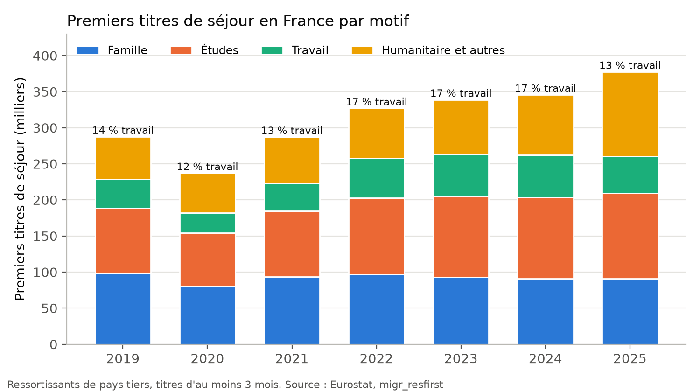

# Immigration, islamisme et identité : analyse et verdicts

**En bref.** Les chiffres de base de Lisnard sont souvent justes : 13 % des premiers titres pour le travail en 2025,
une AME à 1,4 Md€, un taux d'exécution des OQTF très faible, un sondage Ifop fidèlement cité. Il force deux
comparaisons :

- l'écart d'exécution des OQTF avec l'Europe est de 14 à 26 points selon l'année, pas « plus de 35 » ;
- son « 19 % il y a trente ans » vient d'une autre question de l'Ifop.

« Immigration de peuplement » est une interprétation. Le premier motif de délivrance n'est pas la famille mais les
études (31 %). Sa mesure phare, diviser par huit les titres, buterait sur les titres fondés sur des droits : famille
et asile représentent 208 000 titres, soit quatre fois l'objectif.

| Verdict | Nombre | Affirmations |
| --- | --- | --- |
| Exact | 1 | IMMI-01 |
| Plutôt exact | 3 | IMMI-04, 05, 06 |
| Faux | 1 | IMMI-03 (l'écart avec l'Europe ; le faible taux d'exécution est réel) |
| Opinion ou promesse | 1 | IMMI-02 |

Chiffres : `calculs/resultats.csv`. Méthode : `calculs/METHODE.md`. Fichiers : `brut/`, `sources.csv`. Données du
14/11/2026.

---

## IMMI-01 — « Seuls 13 % des nouveaux titres de séjour sont délivrés pour travailler » (11/08/2026)

**Verdict : exact.** Confiance : forte.

- En 2025, 50 848 des 377 462 premiers titres de séjour (13,5 %) ont été délivrés pour un motif professionnel. Les
  autres motifs : études 31 %, humanitaire et divers 31 %, famille 24 %. [M1]
- Le 29 août et le 9 septembre 2026, il dit « 17 % » : c'est le chiffre de 2022 à 2024. Les deux versions sont
  exactes pour leur année, mais il les mélange à trois semaines d'intervalle.
- « 400 000 titres » est un arrondi acceptable (377 000 selon Eurostat). Les « 500 000 entrées annuelles légales »
  (juillet 2026) ne correspondent à aucun chiffre de premiers titres.
- « Immigration de peuplement » est une lecture politique, pas un fait statistique. Une partie des étudiants repart,
  et les titres humanitaires répondent au droit d'asile.

## IMMI-02 — Mesure : « Diviser par huit la délivrance de titres de séjour » (programme)

**Verdict : opinion ou promesse.** Faits vérifiés, chiffrage = **estimation non fiable à 100 %**. [M2]

- Diviser par huit les 377 000 premiers titres de 2025 laisserait environ 47 000 titres. Son objectif d'octobre 2026
  (80 000 entrées, visas étudiants compris) correspond plutôt à une division par 4,7.
- Les titres familiaux et humanitaires représentent à eux seuls 208 000 titres en 2025. Ils découlent en grande partie
  du droit européen (regroupement familial), de l'article 8 de la CEDH (vie familiale) et de la convention de Genève
  (asile). La mesure n'est donc tenable que s'il obtient les changements juridiques qu'il propose par ailleurs
  (référendum, primauté du droit national, sortie de la CEDH en dernier recours). La faisabilité est à soumettre à des
  juristes.

## IMMI-03 — « Le taux d'exécution des OQTF, inférieur de plus de 35 points à la moyenne européenne » (18/01/2024)

**Verdict : faux sur l'écart ; le constat d'une exécution très faible est juste.** Confiance : moyenne (indicateur
approximatif).

- Selon Eurostat, la France renvoie une faible part des étrangers qui ont reçu l'ordre de partir : 7,5 % en 2022,
  8,9 % en 2023, 12,9 % en 2024, 13,8 % en 2025. La Cour des comptes écrit « autour de 10 % ». [M3]
- L'écart avec l'Europe est de 14 points avec l'UE à 27 en 2022 (21,4 %), et de 20 points avec l'UE hors France.
  En 2025, il est de 18 à 26 points selon la comparaison. Jamais 35 points.
- « 95 % des expulsions décidées n'ont jamais lieu » (2023, repris en 2026) : 91 à 92 % n'avaient pas lieu en
  2022-2023, 86 % en 2025. C'est un arrondi défavorable, aujourd'hui dépassé.

## IMMI-04 — « L'Aide médicale d'État coûte près d'1,4 milliard par an pour près de 500 000 bénéficiaires, soit deux fois plus qu'il y a 15 ans » (03/07/2026)

**Verdict : plutôt exact.** Confiance : forte sur le coût, moyenne sur l'évolution.

- Dépenses réelles 2024 : 1 387 M€, dont 1 256 M€ pour l'AME de droit commun. 465 208 bénéficiaires fin 2024 :
  « près de 500 000 » arrondit vers le haut. [M4]
- Les dépenses ont augmenté de 70 % en dix ans selon le Sénat. « Deux fois plus qu'il y a quinze ans » n'a pas pu
  être vérifié précisément avec les fichiers téléchargés.
- Économie d'une suppression (programme : « 700 millions ») : au plus 1,26 Md€ brut, **estimation non fiable à
  100 %**. Le rapport Evin-Stefanini (2023) prévient qu'une aide d'urgence de remplacement et le report de soins vers
  l'hôpital réduiraient l'économie nette, sans la chiffrer.

## IMMI-05 — « 38 % des musulmans de France approuvent désormais tout ou partie des positions islamistes, contre 19 % il y a trente ans » (09/12/2025)

**Verdict : plutôt exact (citation fidèle d'un sondage), comparaison dans le temps fragile.** Confiance : moyenne.

- L'Ifop écrit exactement : « 38 % des Français musulmans approuvent tout ou partie des positions islamistes ».
  Enquête par téléphone du 8 août au 2 septembre 2025, auprès de 1 005 musulmans tirés d'un échantillon de
  14 244 personnes. Marge d'erreur d'environ ±3 points. [M5]
- La comparaison n'est pas directe : l'Ifop précise que 19 % mesurait en 1998 des « positions intégristes », une
  autre question. « Deux fois plus » est donc une lecture de l'institut, pas une mesure identique répétée.
- C'est un sondage commandé par une revue, pas une statistique publique. Pour la religiosité et l'intégration,
  l'enquête publique de référence est Trajectoires et Origines (Insee-Ined), non exploitée ici.

## IMMI-06 — « En vingt ans, les naissances d'enfants de deux parents français ont diminué de 13,7 %, celles d'enfants d'au moins un parent étranger ont augmenté de 63 % » (22/01/2024)

**Verdict : plutôt exact (chiffres d'une fenêtre ancienne).** Confiance : forte.

- Ses chiffres correspondent à 1998-2018 : −13,3 % et +69,5 %. Sur les vingt dernières années connues en janvier
  2024 (2003-2023), la baisse des naissances de deux parents français est plus forte (−24,8 %) et la hausse des
  naissances d'au moins un parent étranger plus faible (+33,8 %). [M6]
- En 2025, 28 % des naissances ont au moins un parent étranger. Attention : la série est rompue en 2023, le « second
  parent » pouvant désormais être une femme.
- « Près de 25 % de naissances en moins qu'en 2010 » (juillet 2026) : 833 654 en 2010, 644 343 en 2025, soit −22,7 %.
  Plutôt exact.

---

## Ce qui reste à faire ou à vérifier

- [ ] Télécharger à la main les tableaux annuels de la DGEF (site protégé) pour recouper Eurostat (titres, OQTF).
- [ ] Retrouver le nombre de bénéficiaires de l'AME vers 2010-2011 pour tester « deux fois plus qu'il y a 15 ans ».
- [ ] Ajouter l'enquête Trajectoires et Origines 2 (Insee-Ined) pour mettre en regard le sondage Ifop.
