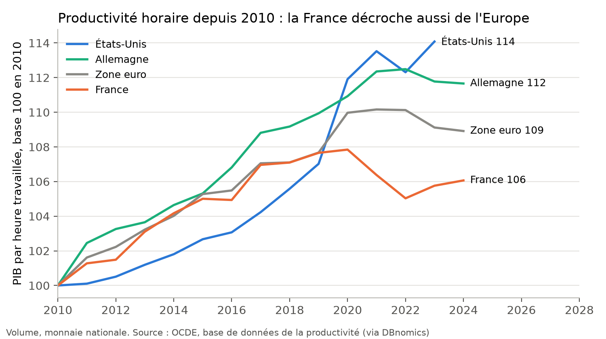

# Économie, travail et entreprises : analyse et verdicts

**En bref.** Les grandes lignes du diagnostic sont confirmées :

- un déficit commercial durable ;
- une industrie manufacturière réduite à 10 % du PIB, la 5e plus faible de l'UE ;
- une productivité française qui stagne ;
- un chômage des jeunes près de trois fois plus élevé qu'en Allemagne.

Mais deux chiffres sont faux ou mal étiquetés. La productivité américaine n'a pas augmenté de 22 % depuis 2010 mais
de 14 %, et l'Europe de 9 %, pas de 5 %. C'est la France qui est à 6 %. Ses chiffres de recherche sont ceux de la R&D
totale, pas de la « recherche publique ». Sur la seule recherche publique, la France dépense un peu plus que les
États-Unis.

| Verdict | Nombre | Affirmations |
| --- | --- | --- |
| Exact | 1 | ECO-04 |
| Plutôt exact | 2 | ECO-01, 02 |
| Trompeur | 1 | ECO-05 |
| Faux | 1 | ECO-03 |

Chiffres : `calculs/resultats.csv`. Méthode : `calculs/METHODE.md`. Fichiers : `brut/`, `sources.csv`. Données du
14/11/2026.

---

## ECO-01 — « Le déficit commercial fut d'environ 80 milliards d'euros en 2024 » (avril 2026)

**Verdict : plutôt exact.** Confiance : moyenne (trois sources, trois définitions).

- En 2024, le solde des échanges de biens est de −103 Md€ selon les données douanières d'Eurostat (importations
  coût, assurance et fret compris) et de −55 Md€ selon les comptes nationaux. Le chiffre des douanes françaises, que
  reprend la presse, se situe entre les deux, autour de −80 Md€. [M1]
- Ses autres chiffres suivent l'évolution réelle : le record de 2022 (« 114 milliards en un an » à mi-2022 ; −193 Md€
  sur l'année selon Eurostat) et le « structurel à 100 milliards » en 2023-2024.
- Depuis 2023, le déficit se réduit, surtout grâce à la baisse de la facture énergétique. En biens et services, il
  n'est plus que de −11 à −14 Md€ en 2024-2025 : les services sont excédentaires.

## ECO-02 — « En part du PIB, la France est l'un des pays devenus les moins industrialisés d'Europe : 10,6 %, contre 16 % pour l'Italie et 13,6 % pour l'Espagne » (avril 2026)

**Verdict : plutôt exact.** Confiance : forte.

- En 2024, l'industrie manufacturière représente 10,2 % du PIB en France (11,4 % de la valeur ajoutée). Ses « 10,3 % »
  et « 10,6 % » sont exacts à quelques dixièmes près. La France est la 5e moins industrialisée de l'UE, après le
  Luxembourg, Chypre, Malte et la Grèce. En 2000, l'industrie représentait 16 % de sa valeur ajoutée. [M2]
- Les comparaisons sont moins rigoureuses. L'Italie est à 15,0 % du PIB, il dit 16 %. L'Allemagne est à 18,1 %, il
  dit 19 %. L'Espagne est à 10,8 %, presque comme la France, et non à 13,6 %. Il semble mélanger la part du PIB, la
  part de la valeur ajoutée et l'industrie au sens large (énergie et mines comprises).

## ECO-03 — « De 2010 à 2023, la productivité du travail a progressé de 22 % aux États-Unis et de 5 % en Europe » (Livre noir, 09/2026)

**Verdict : faux sur les chiffres ; le décrochage est réel.** Confiance : forte.

- Selon l'OCDE, le PIB par heure travaillée a augmenté de 14,1 % aux États-Unis, 9,1 % dans la zone euro, 11,8 % en
  Allemagne et 5,8 % en France de 2010 à 2023. Il majore les États-Unis de moitié et minore l'Europe de moitié. Son
  « 5 % » est en fait celui de la France. [M3]
- Sa version tirée du rapport Draghi (« 98 % du niveau américain en 1995, 82 % en 2019 ») n'est pas reproduite par
  les séries actuelles de l'OCDE en parités courantes (88 % en 1995, 90 % en 2019, 87 % en 2023). L'écart vient des
  méthodes de comparaison des niveaux. La divergence depuis 2019 est bien réelle.
- Conclusion : le décrochage de productivité existe, surtout pour la France depuis 2019. Mais les chiffres qu'il
  avance ne sont pas les bons.

## ECO-04 — « Le chômage des 15-24 ans atteint 18,8 %, contre 6,7 % en Allemagne et moins de 15 % en moyenne dans la zone euro » (29/01/2026)

**Verdict : exact.** Confiance : forte.

- En 2024 (dernière année connue en janvier 2026) : France 18,8 %, Allemagne 6,6 %, zone euro 14,7 %. En 2025, le
  chômage des jeunes a encore augmenté en France (19,8 %). [M4]
- « 8,1 % de chômage au 1er trimestre 2026 (Insee) » : Eurostat publie 8,2 % pour le même trimestre. C'est cohérent.

## ECO-05 — « La recherche publique : la France y consacre 2,2 % du PIB contre 3,1 % en Allemagne et 3,5 % aux États-Unis » (15/05/2026)

**Verdict : trompeur.** Confiance : forte.

- Les chiffres sont exacts, mais pour la R&D **totale** (entreprises comprises) : 2,17 % en France, 3,10 % en
  Allemagne et 3,42 % aux États-Unis en 2023. [M5]
- La recherche **publique** (État et universités) représente 0,70 % du PIB en France, 0,90 % en Allemagne et 0,65 %
  aux États-Unis. Le retard français vient de la R&D des **entreprises** (1,43 % contre 2,66 % aux États-Unis), pas
  de la recherche publique.
- Son argument de fond (la France investit moins dans la recherche) est juste, mais le diagnostic est mal placé, ce
  qui change les remèdes.
